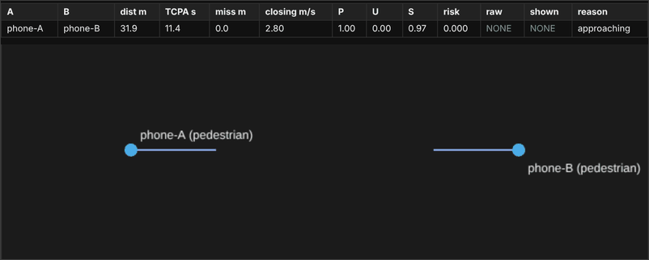
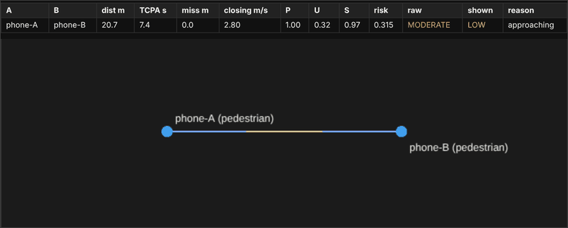
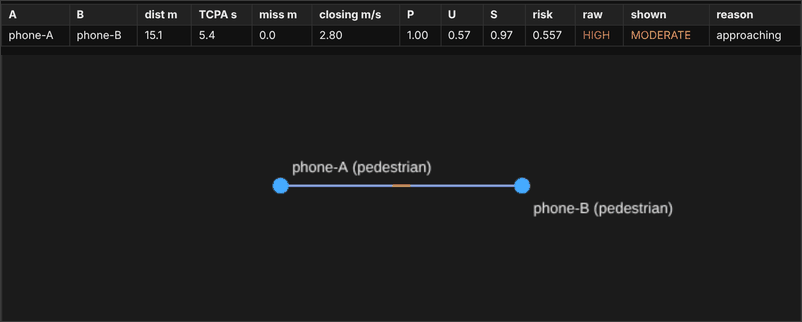
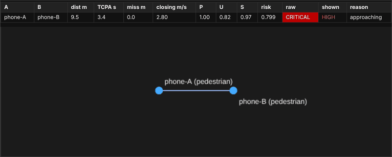
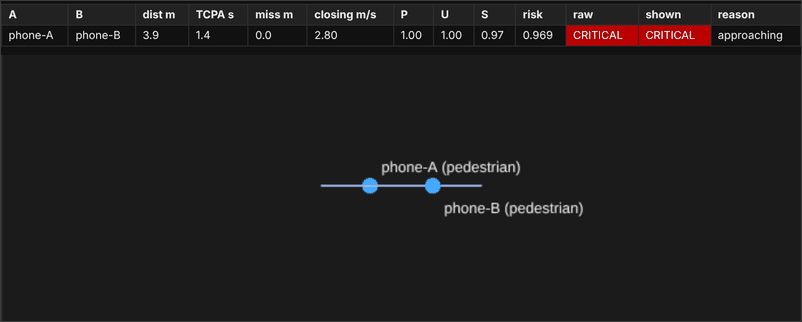
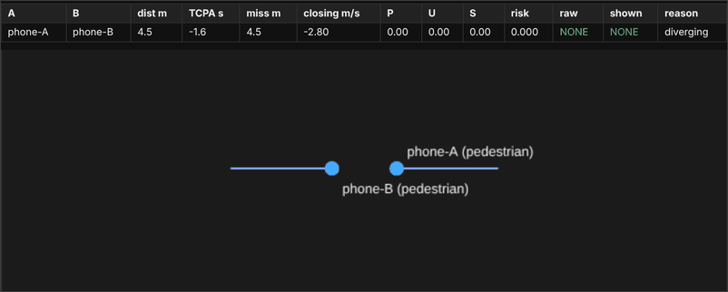
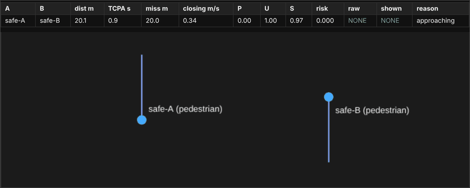

# Safety Alert System

[](https://github.com/rdas25/safety-alert-system/actions/workflows/test.yml)

A real-time collision-alert prototype for pedestrians, cyclists and drivers. Phones share live GPS position with a
small server. Every second the server predicts, for every pair of nearby users, whether their paths are on a collision
course, and pushes an alert level (`NONE`, `LOW`, `MODERATE`, `HIGH`, `CRITICAL`) back to the phones as predicted risk rises. Actual warning time requires field measurement.

**Stack:** React Native (Expo) client, Node.js + WebSocket (`ws`) server, a deterministic closest-point-of-approach
risk model (no ML), unit tests with `node:test`, and a multi-client simulator.

**Status:** prototype with automated tests and simulation screenshots. Physical-phone results, hosted deployment,
threshold calibration, and a phone demo clip are not verified by this repository. See the
[phase-by-phase finish-line audit](docs/FINISH_LINE.md), [field results template](docs/FIELD_RESULTS.md),
and [deployment guide](docs/DEPLOYMENT.md).

## Demo

The inherited images below depict a simulation with the server and risk model and two simulated pedestrians
(`simulation/simulated_agent.mjs`) walking toward each other from 40 m apart at 1.4 m/s each, and the live debug dashboard
(`http://localhost:8080/`). Each frame shows the server's per-pair numbers and the two devices on a north-up map; the
line through each dot is 5 seconds of travel.

**1. Approaching, still far apart.** 31.9 m apart, closest approach 11.4 s away. Urgency `U` is 0, so risk is 0.



**2. LOW.** 20.7 m apart, closest approach in 7.4 s, predicted miss distance 0 m, risk 0.315. The shown level is `LOW`, but the
`raw` level is already `MODERATE` (risk of 0.25 or more); see the note after frame 7.



**3. MODERATE.** 15.1 m, 5.4 s, risk 0.56. `raw` is already `HIGH` while `shown` is still `MODERATE`.



**4. HIGH.** 9.5 m, 3.4 s, risk 0.80. `raw` is already `CRITICAL`.



**5. CRITICAL.** 3.9 m, 1.4 s to the predicted collision.



**6. After passing.** The phones are now moving apart (`reason = diverging`), so the alert clears.



**7. A pass that should not alert.** Two walkers heading in opposite directions on parallel paths 20 m apart. They
approach each other, but the predicted miss distance is 20 m, so the proximity term `P` is 0 and no alert is raised.



**About `raw` and `shown`.** The model produces a `raw` level every second. The server only changes the `shown` level after two
consecutive ticks agree, which removes flicker from noisy GPS. The cost is visible in frames 2 to 4: the level phones
receive trails the raw level by about one step, roughly 1 to 2 seconds. Raising `HIGH` and `CRITICAL` immediately (and
debouncing only the lower levels) would be the first thing to tune with field data.

Level changes in the server log for the head-on run (the numbers are the raw values at the tick when the shown level changed):

```
NONE -> LOW       risk=0.32  tcpa=7.4s  miss=0.0m  closing=2.8m/s  dist=20.7m  reason=approaching
LOW -> MODERATE   risk=0.56  tcpa=5.4s  miss=0.0m  closing=2.8m/s  dist=15.1m  reason=approaching
MODERATE -> HIGH  risk=0.80  tcpa=3.4s  miss=0.0m  closing=2.8m/s  dist=9.5m   reason=approaching
HIGH -> CRITICAL  risk=0.97  tcpa=1.4s  miss=0.0m  closing=2.8m/s  dist=3.9m   reason=approaching
CRITICAL -> NONE  risk=0.00  tcpa=-1.6s miss=4.5m  closing=-2.8m/s dist=4.5m   reason=diverging
```

These historical screenshots use the default `walktest` risk profile, explained [below](#risk-model). Their timing has not been remeasured during this audit; they are not phone-test evidence.

## How it works

```
Phone A --position, 1 Hz--+                              +--status, 1 Hz--> Phone A
                          +--> Backend (WebSocket) ------+
Phone B --position, 1 Hz--+       |                      +--status, 1 Hz--> Phone B
                                  | every second: dead-reckon each device to "now",
                                  | run the risk model on every pair, debounce the level
Browser --> http://<ip>:8080/ ----+ live dashboard (observer)
```

The risk model runs on the server, so there is one implementation to test and one place to log what happened.

Phone to server, once per second (also when standing still, so the server knows the phone is alive):

```json
{"type":"position","deviceId":"dev-k3x9fa","role":"pedestrian","lat":40.4237,"lon":-86.9212,
 "speed":1.4,"heading":92,"accuracy":4.8,"fixAgeMs":310}
```

Server to phone, once per second:

```json
{"type":"status","level":"HIGH","stale":false,"profile":"walktest",
 "threat":{"peerId":"dev-q8m2zz","peerRole":"pedestrian","level":"HIGH","risk":0.707,"tcpaS":4.2,
           "missM":0.0,"closingMps":2.8,"distanceM":11.7,"bearingDeg":90},
 "peers":[{"id":"dev-q8m2zz","role":"pedestrian","lat":40.4237,"lon":-86.9211,"speed":1.4,"heading":270,"level":"HIGH","distM":11.7}]}
```

Details that matter for correctness:

- Each device gets a random ID per app launch; reconnecting with the same ID replaces the old connection.
- Messages are validated (ranges, types, 4 KB max). Devices silent for 30 s are dropped, and data older than 5 s is not
  used for risk.
- A phone's position is dead-reckoned forward by the age of its fix so two devices are compared at the same instant.
- Phones only receive peers within 500 m.

## Risk model

`backend/riskModel.js`, a pure function with no I/O. For two devices, work in local meters with `r` = relative position
and `v` = relative velocity (a device under 0.5 m/s or with unknown heading counts as stationary).

| Step | Formula | Meaning |
|---|---|---|
| Approaching? | `r · v < 0` | Otherwise risk is 0 (moving apart, or same velocity) |
| Time to closest approach | `t* = -(r · v) / abs(v)^2` | Capped at 15 s |
| Predicted miss distance | `miss = abs(r + v * t*)` | Separation at closest approach |
| Proximity | `P = exp(-(miss / D0)^2)`, `D0 = contact radii + sqrt(sigmaA^2 + sigmaB^2)` | Wider region when GPS accuracy is poor |
| Urgency | `U = clamp((10 - t*) / (10 - 2), 0, 1)` | 0 at 10 s or more, 1 at 2 s or less |
| Severity | `S = W_pair * (1 - exp(-(abs(v) / V0)^2))` | Faster closing and more vulnerable pairs score higher |
| Risk | `risk = P * U * S` | Levels: LOW 0.10, MODERATE 0.25, HIGH 0.50, CRITICAL 0.75 |

Multiplying the three terms means a far miss, a distant closest approach, or a harmless closing speed each drive risk
toward zero on their own, so distance and speed interact instead of being added.

Worked example, frame 2 above: `miss = 0` so `P = 1`; `t* = 7.4 s` so `U = (10 - 7.4) / 8 = 0.32`; relative speed 2.8 m/s
with `V0 = 1.5` gives `S = 1 - exp(-3.48) = 0.97`; `risk = 1 * 0.32 * 0.97 = 0.31`, which is at or above the 0.25
MODERATE cutoff (the dashboard shows 0.315 from unrounded inputs).

Two profiles, chosen with `RISK_PROFILE`:

- `walktest` (default): severity saturates at walking speed, so two people on foot can exercise every level. Use it for
  testing.
- `real`: physical severity weights (`V0 = 5 m/s`, two walkers cap at LOW, pedestrian versus car reaches HIGH).

Driver-to-driver pairs are excluded for now, because without road geometry opposing lanes look head-on. All constants
(`T_HOR_S`, `V0_MPS`, cutoffs, contact radii) are hand-chosen starting values, listed at the top of the file.

## Run it

Prerequisites: Node.js 22 or newer (CI targets 22 and 24). No Python is needed. For the phone app you also need a Mac with Xcode
and an iPhone.

### Without any phones

```bash
git clone https://github.com/rdas25/safety-alert-system.git
cd safety-alert-system

# terminal 1: backend (prints the address it listens on)
cd backend && npm install && npm test && npm start

# terminal 2 and 3: two simulated pedestrians, 40 m apart, walking toward each other
cd simulation && npm install
node simulated_agent.mjs phone-A pedestrian 40.4237 -86.9212 90 1.4
node simulated_agent.mjs phone-B pedestrian 40.4237 -86.920728 270 1.4
```

Open `http://localhost:8080/` to watch the dashboard. Useful variations:

```bash
SERVER_URL=ws://<other-computer-ip>:8080 node simulated_agent.mjs ...   # backend on another machine
NOISE_M=3 node simulated_agent.mjs ...                                  # add 3 m of GPS jitter
node ghost_car.mjs <phoneLat> <phoneLon> 6 90 45 0                      # a simulated car aimed at a real phone
RISK_PROFILE=real npm start                                             # in backend/: physical severity
VERBOSE=1 npm start                                                     # in backend/: log every position and pair
```

### With phones (hardware verification pending)

1. Start the backend and note the `<ip>:8080` address it prints. Phones and computer must be on the same network.
   `localhost` on a phone means the phone itself, so the computer's LAN address is required.
2. Put that address in `mobile/config.js` (`DEFAULT_SERVER`), or type it into the app's setup screen.
3. Build and install on an iPhone:

   ```bash
   cd mobile && npm install
   npx expo install --check
   npx expo prebuild --clean --platform ios
   npx expo run:ios --device --configuration Release
   ```

   `react-native-maps` needs a native development build, so Expo Go is not enough. A free Apple ID build expires after
   7 days. Allow Location (While Using, Precise) and Local Network when asked.
4. In the app choose a role, tap Start, and walk toward another phone. The banner colour, alert text and vibration
   follow the server's alert level.

## Tests

Current local result: 18 backend tests and 3 mobile helper tests pass. See [verification details](docs/VERIFICATION.md); remote CI has not run for this change.

```bash
cd backend && npm test
```

The original 11 risk-model tests cover head-on escalation, moving apart, same velocity, wide and narrow passes, crossing at the same and
at different times, a stationary person, unknown heading, both profiles, excluded pairs and poor GPS, symmetry between
the two devices, and dead-reckoning. The server and simulator are exercised end to end by running the
[quick start](#without-any-phones).

## Project structure

```
safety-alert-system/
├── README.md
├── LICENSE
├── .gitignore
├── docs/images/             demo frames used in this README
├── backend/
│   ├── server.js            WebSocket + HTTP server, per-second evaluation loop, debounce
│   ├── riskModel.js         the risk model (pure functions)
│   ├── public/dashboard.html  live debug dashboard
│   ├── test/riskModel.test.js
│   └── package.json
├── mobile/                  Expo app: App.js, config.js, app.json, serverUrl.js
└── simulation/              simulated_agent.mjs, ghost_car.mjs
```

The first version of the model (a distance-only threshold, in Python) is in the git history.

## Recording and tuning

```bash
cd backend
npm run start:log
# After one scenario, Ctrl+C flushes logs/session-*.jsonl.
node replay.js logs/session-<timestamp>.jsonl --timeline
node replay.js logs/session-<timestamp>.jsonl --sweep HIGH=0.3,0.4,0.5,0.6,0.7
```

Record each walk separately. Replay recomputes the model and the shared two-tick debounce from 1 Hz,
already time-aligned device snapshots. It uses the recorded profile and resets debounce across missing/stale pairs
or gaps over 2 s. It does not reconstruct between-sample motion or reproduce historical versions of the model.
Counts are per pair per file, not per second. `TRUE_ALERT`, `MISSED`, `FALSE_ALERT`, and `QUIET` compare any shown
HIGH-or-higher alert against minimum sampled GPS distance <=5 m. These are rough proxies: verify them against notes,
exclude incomplete passes, and do not treat them as ground truth. Negative `warningS` means the first warning came
after the closest recorded point. Missing/poor-GPS observations cannot establish a quiet result.
No cutoff has been tuned from real data yet.

## Design choices and limits

WebSockets keep one bidirectional connection for 1 Hz updates and server pushes. Central evaluation gives each pair
one model and debounce state. Deterministic geometry is explainable and testable without a labeled training set;
ML trajectory prediction would need representative data first.

This is a foreground prototype: no background tracking, accounts, road geometry, or guaranteed warning delivery.
GPS noise, stale fixes, straight-line motion, and two-tick debounce affect warning timing. Driver pairs are excluded.
`walktest` is for walking demonstrations and does not validate road safety. Device IDs are self-asserted; anyone with
the server address can submit positions and receive nearby peers. Dashboard tokens do not authenticate phones.
Use controlled sessions with consenting participants. Scaling is quadratic in the number of active devices.

## Privacy

While tracking is open, phones send an ephemeral ID, role, location, speed, heading, GPS accuracy and fix age once per
second. Stop ends tracking. Peers within 500 m receive positions; authorized dashboard viewers see all active devices.
With no `ADMIN_TOKEN`, local dashboard access is unrestricted. Production refuses to start without a token.
`LOG_POSITIONS=1` records 1 Hz snapshots including locations and pair risk values on server disk; default is off.
Logs are not automatically deleted and must be removed after the agreed retention period. Downloads require the
admin token when configured. Keep raw logs and tokens private; publish only redacted aggregates with consent.
See [deployment](docs/DEPLOYMENT.md) for token handling and ephemeral storage.

## License

MIT; see [LICENSE](LICENSE).
